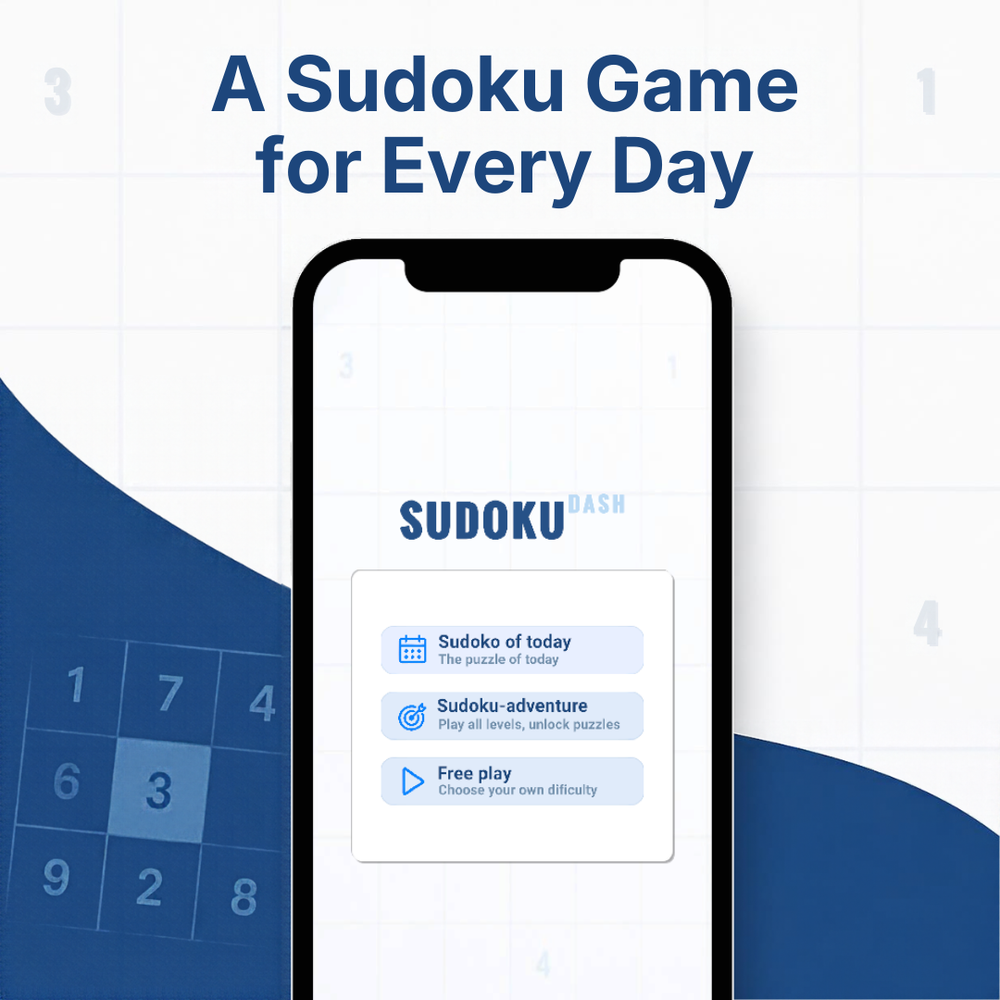
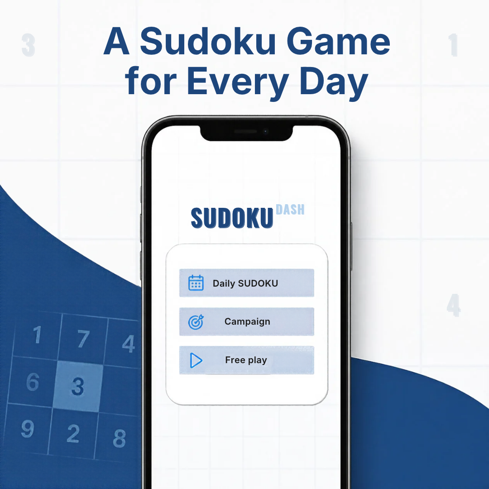

# Sudoku App

A Sudoku game built in Unity with procedurally generated puzzles, multiple board sizes, daily challenges, and campaign progression.

This project was created as a portfolio piece focused on gameplay programming, deterministic content generation, algorithm design, UI state management, and persistent progression.

## Features

- **Three game modes**: Daily Sudoku, Free Play, and Campaign
- **Three board sizes**:
  - Nano — 4x4 board with 2x2 regions
  - Mini — 6x6 board with 3x2 regions
  - Classic — 9x9 board with 3x3 regions
- **Three difficulty levels** based on the number of starting clues
- **110 campaign levels** with unlock progression and one-to-three-star results
- Notes mode, undo, erase, keyboard input, and visual feedback
- Up to five hints per puzzle, with a cooldown and time penalty
- Timer and mistake tracking
- Local campaign progress saved between sessions
- Automated EditMode tests for puzzle generation

## Screenshots






## How the App Works

The main menu provides three ways to start a puzzle:

### Daily Sudoku

The current date is converted into a deterministic seed. This means every player receives the same Classic, Medium puzzle for a given day without requiring a server or a stored puzzle library.

### Free Play

Players choose a Nano, Mini, or Classic board and select Easy, Medium, or Hard difficulty. A seed based on the current time creates a new puzzle for each session.

### Campaign

The campaign contains five Nano levels, five Mini levels, and 100 Classic levels. Levels use their campaign index as part of the seed, so each level remains reproducible.

Completing a campaign level records the best result locally. Stars are calculated from completion time and mistakes, with thresholds adjusted for board size and difficulty. A rolling unlock system allows limited progression beyond completed levels without exposing the entire campaign at once.

## Gameplay

Select an empty cell and enter a number using the on-screen controls or the keyboard. Every move is checked against the Sudoku rules for its row, column, and region.

Available helper tools include:

- **Pen / Notes** — switch between entering final values and candidate notes
- **Undo** — restore the previous value or notes state
- **Erase** — clear a non-given cell
- **Hint** — fill a random empty cell with its correct value

Hints are limited to five per puzzle, have a 30-second cooldown, and add a one-minute penalty to the timer. Invalid moves increase the mistake count and trigger visual feedback. The result panel displays the final time and mistakes, along with stars for campaign levels.

### Keyboard Controls

| Input | Action |
| --- | --- |
| `1`–`9` or numpad digits | Enter a value supported by the current board size |
| `0`, numpad `0`, `Backspace`, or `Delete` | Erase the selected cell |

## Puzzle Generation

Puzzles are generated at runtime rather than loaded from predefined data.

1. A seeded pseudo-random number generator shuffles candidate values.
2. Recursive backtracking builds a complete, valid Sudoku solution.
3. Cell positions are shuffled and clues are removed one at a time.
4. After each removal, a solver counts solutions up to a limit of two.
5. A clue is kept removed only when the puzzle still has exactly one solution.

The solution counter uses a **minimum remaining values** strategy: it searches from the empty cell with the fewest legal candidates. This reduces unnecessary branches when checking puzzle uniqueness. It also exits as soon as a second solution is found, because further counting is not needed.

Difficulty is controlled through target clue ratios:

| Difficulty | Target clues |
| --- | ---: |
| Easy | 60% of cells |
| Medium | 50% of cells |
| Hard | 40% of cells |

Clue removal also protects against leaving a row, column, or region without any given values. If reaching a target would break uniqueness or these structural safeguards, the generator keeps the required clue.

## Techniques Demonstrated

### Deterministic procedural generation

Text identifiers such as a date or campaign level are converted into stable integer seeds using an FNV-1a-style hash. The same identifier, settings, and board dimensions produce the same puzzle, while Free Play can still create fresh boards.

### Backtracking and constraint validation

The generator and solver share Sudoku constraints across rows, columns, and variably sized regions. The same implementation supports 4x4, 6x6, and 9x9 boards by accepting grid and region dimensions as parameters.

### Separation of responsibilities

The code is divided into focused components:

- `SudokuPuzzleGenerator` creates solutions and unique puzzles.
- `SudokuGameManager` owns the active board, input validation, timer, mistakes, hints, undo history, and win state.
- `SudokuCell` manages cell presentation, notes, selection, and feedback animation.
- `CampaignManager` defines levels, calculates stars, controls unlocks, and persists progress.
- Panel controllers connect menu choices and gameplay actions to Unity UI.

### UI state and feedback

Buttons update their interactable and visual state based on the current selection, undo history, hint availability, and active input mode. Coroutines provide temporary correct/incorrect feedback without blocking the game loop.

### Lightweight local persistence

Unity `PlayerPrefs` stores menu selections and campaign results. Campaign progress is serialized as JSON per level, including best time, stars, and mistakes.

### Automated verification

NUnit EditMode tests validate all supported board sizes. They check that generated puzzles:

- Have the expected dimensions
- Contain valid row, column, and region values
- Have exactly one solution
- Remain solvable at every Classic difficulty
- Preserve the expected Easy-to-Hard clue ordering

## Project Structure

```text
Assets/
├── Scenes/                 # Main menu and board-size-specific scenes
├── Script/                 # Runtime gameplay, generation, and UI code
└── Tests/EditMode/         # Puzzle generator tests
Packages/                   # Unity package manifest and lock file
ProjectSettings/            # Unity editor and build configuration
```

The enabled scenes are:

- `MainMenu`
- `SudokuNano`
- `SudokuMini`
- `SudokuClassic`

## Built With

- Unity `6000.6.5f1`
- C# / .NET Standard 2.1
- Unity Input System
- Unity UI and TextMesh Pro
- Universal Render Pipeline
- Unity Test Framework with NUnit

## Getting Started

### Requirements

- Unity Hub
- Unity Editor `6000.6.5f1` or a compatible Unity 6 version

### Run the Project

1. Clone the repository.
2. Add the repository folder as a project in Unity Hub.
3. Open it with Unity `6000.6.5f1`.
4. Open `Assets/Scenes/MainMenu.unity`.
5. Enter Play Mode.

Unity resolves the required packages from `Packages/manifest.json` when the project is opened.

## Running the Tests

1. In Unity, open **Window > General > Test Runner**.
2. Select **EditMode**.
3. Run all tests.

The generator test suite is located at `Assets/Tests/EditMode/SudokuPuzzleGeneratorTests.cs`.
